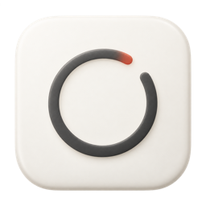
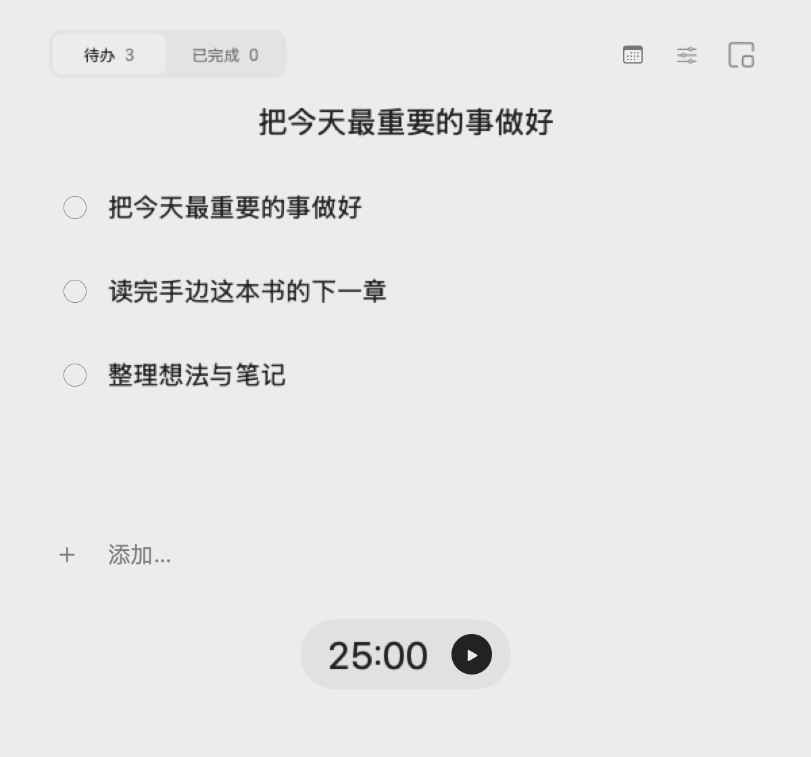
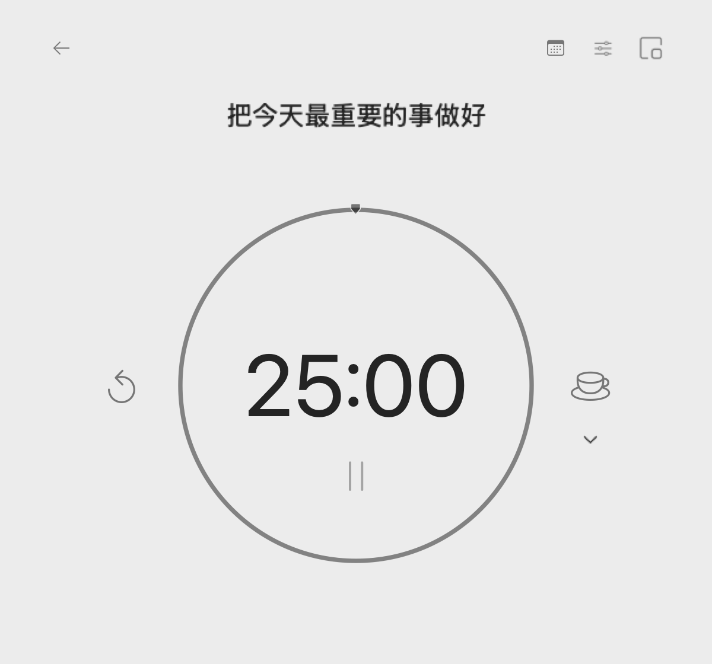
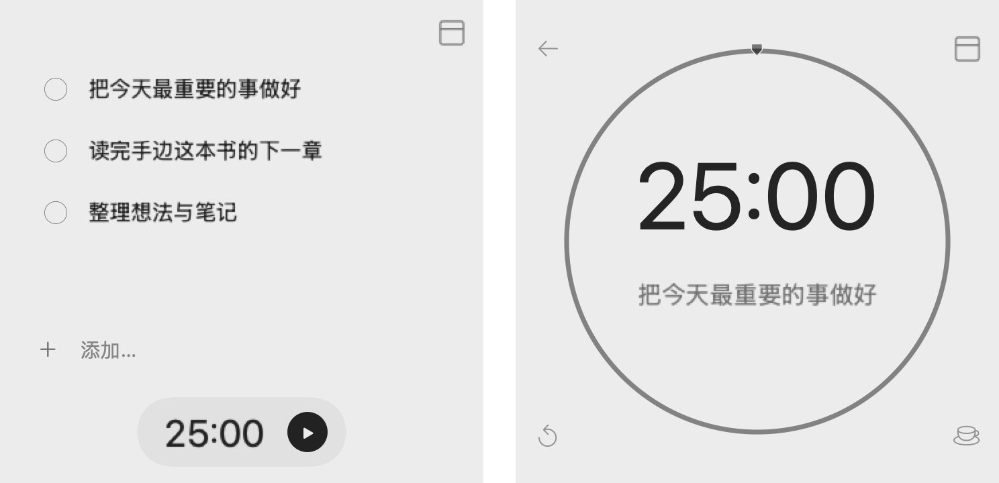

  

<h1 align="center">留白</h1>

极简待办与番茄钟，给专注留一点空间。

  <a href="https://github.com/Raphaelque/liubai-releases/releases/latest"><strong>下载 macOS 版</strong></a>

macOS 14+ · Apple 芯片 / Intel

 

### 待办

回车添加，双击编辑，拖动排序。

  

### 专注

点击计时，长按进入专注，随时切换休息。

  

### 极简

缩成小窗，把当前任务留在手边。

  

