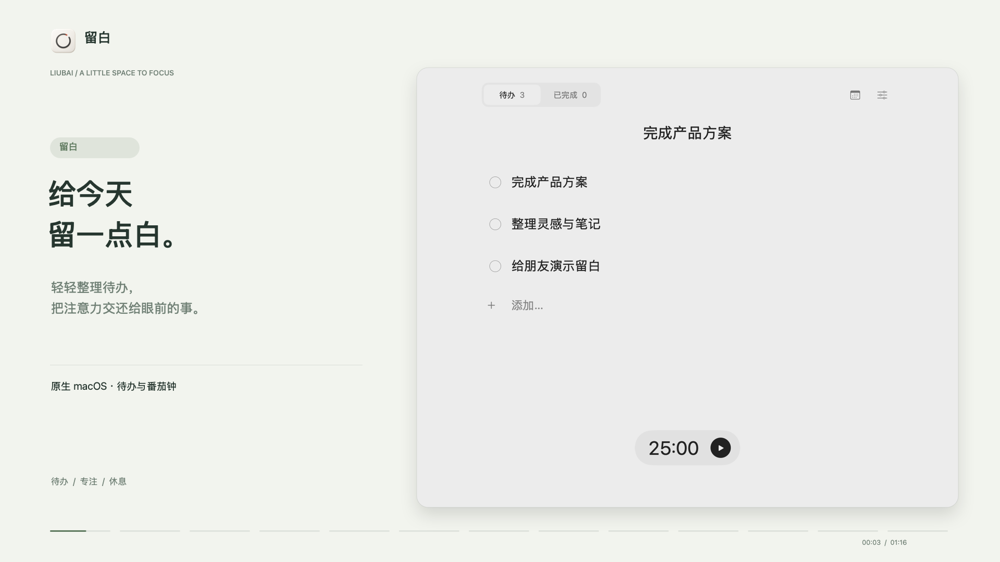
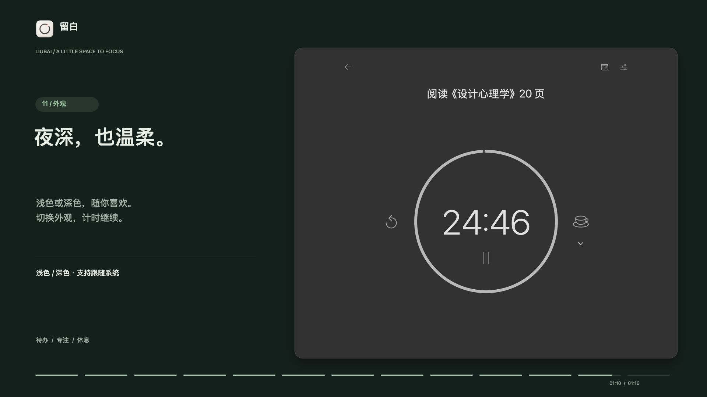

  

<h1 align="center">留白 · Liubai</h1>

<strong>给今天，留一点白。</strong>

  一款轻巧的原生 macOS 待办与番茄钟应用。 
  记下想做的事，把注意力交还给眼前这一件。

  <a href="https://github.com/Raphaelque/liubai-releases/releases/latest"><strong>下载 macOS 版</strong></a>
  &nbsp; · &nbsp;
  <a href="https://github.com/Raphaelque/liubai-releases/releases">更新记录</a>
  &nbsp; · &nbsp;
  <a href="https://github.com/Raphaelque/liubai-releases/issues">问题反馈</a>

macOS 14 或以上 · Apple 芯片与 Intel Mac 通用

 

## 少一点纷扰，多一点专注

| 轻轻整理 | 安心专注 | 留在手边 |
| :--- | :--- | :--- |
| 记下待办、双击修改、拖动排序。排在第一项的，就是当前任务。 | 点击开始番茄钟，长按进入专注。圆环与倒计时，让时间一眼可见。 | 切换为小巧的极简窗口，或从菜单栏查看进度。关闭窗口，计时继续。 |

- **按自己的节奏休息** — 自定义专注与长短休息时长，中途休息保留专注剩余时间。
- **和 Apple 日历一起用** — 按需连接，为任务单独安排日期与时段，批量提交前检查冲突。
- **白天与夜晚，都从容** — 浅色、深色或跟随系统，延续安静的黑白灰。
- **数据留在本机** — 本地保存任务、设置与计时状态，不上传任务、日历或计时数据。

 

以上为真实应用界面的演示画面，使用示例任务。

## 从第一件小事开始

1. **安装留白** — 打开[最新版下载页](https://github.com/Raphaelque/liubai-releases/releases/latest)，在附件（Assets）中选择 `.dmg`，打开后将「留白」拖入「应用程序」。
2. **写下待办** — 打开留白，输入任务后按回车。拖动可以排序，双击可以原地修改。
3. **开始专注** — 点击底部计时器开始或暂停，持续长按进入专注；点击圆环内任意位置暂停或继续。
4. **完成，再往前一点** — 点击清单中的圆圈完成任务；需要休息时，点击专注页的咖啡按钮。

留白常驻屏幕顶部的菜单栏，不在程序坞显示。关闭主窗口后，可以从菜单栏重新打开，也可以进入设置、检查更新或退出。

## 安装与使用

<strong>第一次安装时出现系统安全提示？</strong>

留白目前采用社区分发方式，不通过 Mac App Store，安装包尚未经过 Apple 公证，因此 macOS 可能显示安全提示。请从本仓库的正式 Release 下载安装包，并按系统提示处理。

<strong>之后如何更新？</strong>

应用会自动检查更新，有新版时在设置页提示；也可以从菜单栏或设置中主动「检查更新」。自动下载可在设置中选择，安装更新会保留本地任务、设置与计时状态。

0.1.0 用户需先手动安装一次最新版，之后即可使用应用内更新。

<strong>必须连接日历吗？数据保存在哪里？</strong>

日历是可选功能，仅在你主动启用后请求系统授权。完成或删除任务，不会连带删除已关联的日历事件。

任务、设置与计时状态保存在本机 `~/Library/Application Support/Liubai/`，可从设置打开数据目录。应用不上传任务、日历或计时数据；检查更新时会访问 GitHub 的公开更新服务。Apple 日历账户自身的同步由系统管理。

<strong>安装包与更新文件有什么区别？</strong>

首次安装请选择 **DMG**。ZIP 用于应用内更新，`appcast.xml` 和 `latest.json` 是更新索引，无需手动安装。

更新归档使用 Ed25519 签名，应用安装更新前会校验签名。技术入口：[Sparkle 更新索引](https://github.com/Raphaelque/liubai-releases/releases/latest/download/appcast.xml) · [版本清单](https://github.com/Raphaelque/liubai-releases/releases/latest/download/latest.json)。

 

  留白 · 为专注留一点空间。 此仓库提供安装包、应用介绍与更新信息；应用源码不在此公开。

